# ERD — Business Monitoring System

Generated after Phase 2 (migrations + models). Covers every business table;
framework tables (`users`, `sessions`, `cache`, `jobs`, `notifications`,
`activity_log`, permission tables) are omitted for readability except where
they're referenced by a foreign key.

```mermaid
erDiagram
    CATEGORIES ||--o{ PRODUCTS : "has"
    BRANDS ||--o{ PRODUCTS : "has"
    SUPPLIERS ||--o{ PRODUCTS : "supplies"
    SUB_RACKS ||--o{ PRODUCTS : "stores"
    RACKS ||--o{ SUB_RACKS : "has"
    PRODUCT_CODE_COUNTERS ||--o{ CATEGORIES : "prefix counter for"

    PRODUCTS ||--o{ PRODUCT_BATCHES : "has"
    PRODUCTS ||--o{ MARKETPLACE_SKU_MAPPINGS : "maps to"
    PRODUCTS ||--o{ STOCK_MOVEMENTS : "moves"
    PRODUCTS ||--o{ STOCK_OPNAME_ITEMS : "counted in"
    PRODUCTS ||--o{ PURCHASE_ITEMS : "purchased as"
    PRODUCTS ||--o{ PURCHASE_RETURN_ITEMS : "returned as"
    PRODUCTS ||--o{ SALE_ITEMS : "sold as"

    STOCK_OPNAMES ||--o{ STOCK_OPNAME_ITEMS : "contains"

    SUPPLIERS ||--o{ PURCHASES : "fulfills"
    PURCHASES ||--o{ PURCHASE_ITEMS : "contains"
    PURCHASES ||--o{ PURCHASE_PAYMENTS : "paid via"
    PURCHASES ||--o{ PURCHASE_RETURNS : "returned via"
    PURCHASE_RETURNS ||--o{ PURCHASE_RETURN_ITEMS : "contains"

    SALES ||--o{ SALE_ITEMS : "contains"

    USERS ||--o{ PURCHASES : "recorded by"
    USERS ||--o{ SALES : "recorded by"
    USERS ||--o{ STOCK_MOVEMENTS : "recorded by"
    USERS ||--o{ STOCK_OPNAMES : "conducted by"
    USERS ||--o{ FINANCE_TRANSACTIONS : "recorded by"
    USERS ||--o{ REPORTS_LOG : "requested by"

    CATEGORIES {
        bigint id PK
        string name
        string slug UK
        string prefix UK "e.g. SKN, HRB"
        string icon
        boolean is_active
        timestamp deleted_at
    }

    BRANDS {
        bigint id PK
        string name
        string slug UK
        boolean is_active
        timestamp deleted_at
    }

    SUPPLIERS {
        bigint id PK
        string name
        string contact_person
        string phone
        string email
        smallint lead_time_days
        boolean is_active
        timestamp deleted_at
    }

    RACKS {
        bigint id PK
        string code UK
        string name
    }

    SUB_RACKS {
        bigint id PK
        bigint rack_id FK
        string code UK
        string name
    }

    PRODUCT_CODE_COUNTERS {
        bigint id PK
        string prefix UK
        int last_number
    }

    PRODUCTS {
        bigint id PK
        string kode_barang UK "SKN-000001"
        string sku UK
        string barcode UK
        string qr_code UK
        string name
        bigint category_id FK
        bigint brand_id FK
        bigint supplier_id FK
        bigint sub_rack_id FK
        bigint harga_modal
        bigint harga_jual
        bigint harga_marketplace
        int berat "grams"
        int current_stock "cache, source of truth = stock_movements"
        int min_stock
        enum status "active, inactive"
        timestamp deleted_at
    }

    PRODUCT_BATCHES {
        bigint id PK
        bigint product_id FK
        string batch_number
        date expired_date
        int qty
    }

    MARKETPLACE_SKU_MAPPINGS {
        bigint id PK
        bigint product_id FK
        enum marketplace "shopee, tiktok"
        string marketplace_sku
        string marketplace_product_name
    }

    STOCK_MOVEMENTS {
        bigint id PK
        bigint product_id FK
        enum type "in, out, adjustment, opname, damage, lost, return"
        int qty "signed"
        int qty_before
        int qty_after
        string reference_type "polymorphic: Purchase, Sale, StockOpname..."
        bigint reference_id
        bigint user_id FK
    }

    STOCK_OPNAMES {
        bigint id PK
        string code UK
        enum status "draft, in_progress, completed"
        timestamp started_at
        timestamp completed_at
        bigint user_id FK
    }

    STOCK_OPNAME_ITEMS {
        bigint id PK
        bigint stock_opname_id FK
        bigint product_id FK
        int system_qty
        int physical_qty
        int difference
        enum status "pending, checked"
    }

    PURCHASES {
        bigint id PK
        string code UK
        bigint supplier_id FK
        enum status "draft, ordered, received, cancelled"
        date purchase_date
        bigint total_amount
        bigint paid_amount
        string nota "uploaded file path"
        bigint user_id FK
        timestamp deleted_at
    }

    PURCHASE_ITEMS {
        bigint id PK
        bigint purchase_id FK
        bigint product_id FK
        int qty
        bigint price
        bigint subtotal
    }

    PURCHASE_PAYMENTS {
        bigint id PK
        bigint purchase_id FK
        bigint amount
        date payment_date
        enum method "cash, transfer, other"
    }

    PURCHASE_RETURNS {
        bigint id PK
        string code UK
        bigint purchase_id FK
        date return_date
        bigint total_amount
        bigint user_id FK
    }

    PURCHASE_RETURN_ITEMS {
        bigint id PK
        bigint purchase_return_id FK
        bigint product_id FK
        int qty
        bigint price
        bigint subtotal
    }

    SALES {
        bigint id PK
        string code UK
        enum marketplace "manual, shopee, tiktok"
        string marketplace_order_id
        string customer_name
        enum status "pending, processing, completed, cancelled"
        date sale_date
        bigint total_amount
        bigint shipping_cost
        bigint admin_fee
        bigint user_id FK
        timestamp deleted_at
    }

    SALE_ITEMS {
        bigint id PK
        bigint sale_id FK
        bigint product_id FK
        int qty
        bigint price
        bigint subtotal
    }

    FINANCE_TRANSACTIONS {
        bigint id PK
        enum type "income, expense"
        string category
        bigint amount
        date transaction_date
        string reference_type "polymorphic"
        bigint reference_id
        bigint user_id FK
    }

    REPORTS_LOG {
        bigint id PK
        string type
        enum format "pdf, excel"
        enum status "processing, completed, failed"
        string file_path
        bigint requested_by FK
        timestamp completed_at
    }

    SETTINGS {
        bigint id PK
        string key UK
        text value
    }
```

## Notes

- **`stock_movements` is the single source of truth for inventory.** Every
  stock-changing action (purchase received, sale completed, opname
  adjustment, manual damage/loss/return) writes a row here. `products.current_stock`
  is a denormalized cache kept in sync by `StockService` for fast dashboard
  reads — never write to it directly.
- **`reference_type`/`reference_id`** on `stock_movements` and
  `finance_transactions` are polymorphic pointers (e.g. to a `Purchase`,
  `Sale`, or `StockOpname`) so every ledger entry can be traced back to the
  transaction that caused it.
- **Soft deletes** are applied to the four master-data tables the brief calls
  out (`categories`, `brands`, `suppliers`, `products`) plus the two
  transactional headers that must keep historical records after deletion
  (`purchases`, `sales`). Line-item and ledger tables are not soft-deleted —
  they're deleted via their parent's cascade.
- **`product_code_counters`** backs the thread-safe `kode_barang` generator
  (`ProductObserver` + `ProductCodeService`): one row per category prefix,
  incremented under a row lock inside a transaction.
